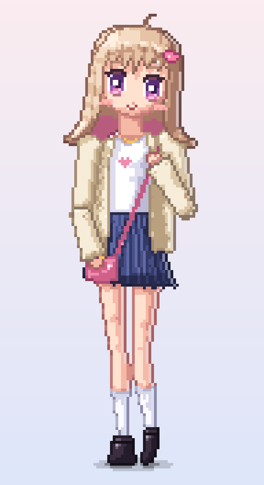

# 画像生成を使わずにドット絵のアニメキャラクターを描くための資料集

生成AI（LLM）に渡して、**画像生成モデルを使わずに、テキストとコードだけで** アニメ調のドット絵キャラクターを描けるようにするための資料です。



## 資料

| No. | ファイル | 内容 |
|---|---|---|
| 00 | [docs/00_ai_pixel_protocol.md](docs/00_ai_pixel_protocol.md) | **最初に読む**。AIがドット絵を描く手順（文字グリッド方式／図形ラスタライズ方式）、ジャギー・色・輪郭のルール、サイズ別の目安、セルフチェック表 |
| ① | [docs/01_human_body.md](docs/01_human_body.md) | 人体の構造：プロポーション表、骨格、筋肉、皮膚（肌の色ランプと影の位置）、髪の毛（レイヤー、束、影、天使の輪、髪色ランプ） |
| ② | [docs/02_clothing_folds.md](docs/02_clothing_folds.md) | 服の皺：支点、7種類の皺、素材ごとの違い、ドットパターン（プリーツ、ギャザー、リブなど）、重ね着 |
| ③ | [docs/03_facial_expressions.md](docs/03_facial_expressions.md) | 表情：パーツごとのパラメータ表、目・口・眉のドットテンプレート、頬や汗などの記号 |
| ④ | [docs/04_modern_anime_design.md](docs/04_modern_anime_design.md) | 最近（2020年代）のアニメキャラデザイン：目・顔・髪の今っぽさ、ジャンル別の特徴、キャラ設計の手順 |
| ⑤ | [docs/05_light_and_shadow.md](docs/05_light_and_shadow.md) | 光と影：形状影と落ち影、セル塗りの段階、影の位置チートシート、影の色の決め方（HSV）、影を計算で付けるアルゴリズム |
| ⑥ | [docs/06_fashion_design.md](docs/06_fashion_design.md) | ファッション：シルエット、配色（70/25/5）、素材、2025〜26年ごろのトレンド、コーデの組み立て方 |
| ⑦ | [docs/07_anime_face_and_body.md](docs/07_anime_face_and_body.md) | アニメキャラの顔・体：顔の比率、3/4向き・横顔、体の構成、可愛いポーズ、**ピクセル座標の標準テンプレート**、よくある破綻 |
| ⑧ | [docs/08_volume_and_depth.md](docs/08_volume_and_depth.md) | **立体感の出し方**：平面的に見える原因の診断、光の家族と影の家族、単純な立体への置き換え、面積とコントラスト、線の強弱、クロスコンター、重なり・アングル、リムライト、**法線推定で陰影を計算する方法** |
| ⑨ | [docs/09_proportion_pose_anatomy.md](docs/09_proportion_pose_anatomy.md) | **体の比率・顔の比率・ポーズ・人体構造の検討**：描いた絵の計測と問題点、比率の関係と目安、ルーミス法をもとにしたアニメ顔の比率、重心とコントラポスト、骨の長さと短縮、**骨格から肉付けして描く方法** |

## 制作例

[character/](character/) に、資料をもとに描いた「現代風の可愛い女性キャラクター」の例があります。

- `character/draw_mio.py`：描画スクリプト（Python + numpy + Pillow）
- `character/output/`：PNG（等倍・6倍）とアイドルアニメ GIF、改善の比較（`compare_v1_v2_v3.png`）、ポーズの検討図（`pose_skeleton_x5.png`）
- `character/README.md`：キャラ仕様、描き方、セルフレビューで直した点

## 生成AIへの渡し方（例）

```text
添付の資料 00〜09 を読んでください。00 の手順に従い、
画像生成は使わずに、Python（numpy, Pillow）でドット絵を描いてください。
キャラクター: 〇〇（年齢感、性格、髪型、服、小物、ポーズ）
キャンバス: 96×156px、正面立ち
完成したら PNG を拡大表示して、00 のセルフチェック表で確認・修正してください。
```

## 調査で参照した主な情報源

- ドット絵の色ランプ・色相シフト：[gamedev.net "Color Palettes"](https://www.gamedev.net/articles/visual-arts/color-palettes-r4964/)、[Stardew Valley Modding Wiki "How to make pixel art"](https://stardewmodding.wiki.gg/wiki/How_to_make_pixel_art)、[BuskHusker's GBA Portraiting Tutorials](https://feuniverse.us/t/buskhuskers-gba-portraiting-tutorials/10927)、[Aseprite Community（Pixelblog 29 アニメ顔と髪）](https://community.aseprite.org/t/anime-face-based-off-slyndyrd/19607)
- アニメの影・線の傾向：[文春オンライン（ゲゲゲの鬼太郎 第6期キャラクターデザイン）](https://bunshun.jp/articles/-/9168)、[Impression Change of a Female Character in Illustration by Shadow](https://openaccess.cms-conferences.org/publications/book/978-1-964867-13-7/article/978-1-964867-13-7_16)、[animetics "Line Theory 101"](https://animetics.net/2014/12/20/fun-with-numbers-line-theory-101/)
- 立体感：[Proko "Practical Guide to Realistic Shading"](https://proko.com/880)、[The Drawing Source "Value, Light and Form"](https://www.thedrawingsource.com/light-and-form.html)、[Skillshare "10 minutes to better drawing: Values"](https://www.skillshare.com/en/classes/10-minutes-to-better-drawing-values/1530960833)、[OpenGameArt "Chapter 4: Shadow and light"](https://opengameart.org/content/chapter-4-shadow-and-light)、[Pokebip「Lexique du pixel-art」](https://www.pokebip.com/page/fanarts/tutos/pixel-art/lexique)、[CLIP STUDIO 公式講座](https://www.clipstudio.net/oekaki/archives/151107)、[マイナビニュース（線の強弱）](https://news.mynavi.jp/article/pentaball-25/)、[Adobe「奥行き」](https://www.adobe.com/jp/creativecloud/roc/blog/design/quiz-challenge/depth.html)、[itch.io devlog（リムライト）](https://pixel-beef.itch.io/xdasher/devlog/192949/4-things-we-did-to-add-light-and-depth-to-our-pixel-art-game)
- 比率・ポーズ・人体構造：[Life Drawing Academy "Contrapposto"](https://lifedrawing.academy/drawing-lessons/contrapposto)、[Life Drawing Academy "Female Body in Contrapposto"](https://lifedrawing.academy/drawing-lessons/how-to-draw-female-body)、[Getty "Strike a Pose"](https://www.getty.edu/education/k-12-learning/strike-a-pose-exploring-contrapposto)、[UW CSE458 "Posing"](https://courses.cs.washington.edu/courses/cse458/20au/content/projects/project6_animation_a/index.html)、[PoseMy.Art](https://posemy.art/blog/how-to-draw-dynamic-poses-guide/)、[Fine Art Tutorials "Loomis Method"](https://finearttutorials.com/guide/loomis-method/)、[Proko "How to Draw the Head"](https://proko.com/course-lesson/how-to-draw-the-head-front-view/notes)、[CLIP STUDIO 公式講座（頭身）](https://www.clipstudio.net/oekaki/archives/151156)、[Anime Art Academy（頭身と年齢）](https://animeartacademy.artstation.com/projects/qeLrNN)、[MediBang Paint（男女の骨格）](https://medibangpaint.com/en/use/2021/03/differences-between-male-and-female-skeletons)
- ファッショントレンド：[Korea JoongAng Daily "Y2K fashion"](https://www.koreajoongangdaily.com/opinion/talking-trends-y2k-fashion/11024699)、[FUGA Studios "Korean fashion trends"](https://fuga-studios.com/en/blogs/journal/korean-fashion-trends)、[fun-japan](https://www.fun-japan.jp/jp/articles/14417)

※ 人体の比率、皺の分類、表情、色彩の基礎などは、一般的な作画・デッサンの知識をドット絵向けに整理したものです。
