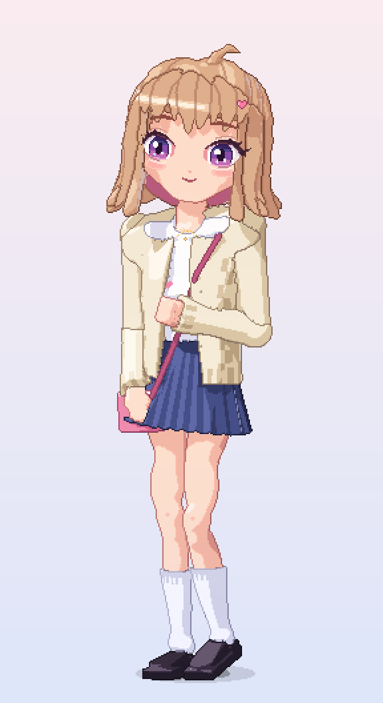

# 画像生成を使わずにドット絵のアニメキャラクターを描くための資料集

生成AI（LLM）に渡して、**画像生成モデルを使わずに、テキストとコードだけで** アニメ調のドット絵キャラクターを描けるようにするための資料です。



## 資料

| No. | ファイル | 内容 |
|---|---|---|
| 00 | [docs/00_ai_pixel_protocol.md](docs/00_ai_pixel_protocol.md) | **最初に読む**。AIがドット絵を描く手順（文字グリッド方式／図形ラスタライズ方式）、ジャギー・色・輪郭のルール、サイズ別の目安、セルフチェック表 |
| ① | [docs/01_human_body.md](docs/01_human_body.md) | 人体の構造：プロポーション表、骨格、筋肉、皮膚（肌の色ランプと影の位置）、髪の毛（レイヤー、束、影、天使の輪、髪色ランプ） |
| ② | [docs/02_clothing_folds.md](docs/02_clothing_folds.md) | 服の皺：支点、7種類の皺、素材ごとの違い、ドットパターン（プリーツ、ギャザー、リブなど）、重ね着 |
| ③ | [docs/03_facial_expressions.md](docs/03_facial_expressions.md) | 表情：パーツごとのパラメータ表、目・口・眉のドットテンプレート、頬や汗などの記号 |
| ④ | [docs/04_modern_anime_design.md](docs/04_modern_anime_design.md) | 最近（2020年代）のアニメキャラデザイン：目・顔・髪の今っぽさ、ジャンル別の特徴、キャラ設計の手順 |
| ⑤ | [docs/05_light_and_shadow.md](docs/05_light_and_shadow.md) | 光と影：形状影と落ち影、セル塗りの段階、影の位置チートシート、影の色の決め方（HSV）、影を計算で付けるアルゴリズム |
| ⑥ | [docs/06_fashion_design.md](docs/06_fashion_design.md) | ファッション：シルエット、配色（70/25/5）、素材、2025〜26年ごろのトレンド、コーデの組み立て方 |
| ⑦ | [docs/07_anime_face_and_body.md](docs/07_anime_face_and_body.md) | アニメキャラの顔・体：顔の比率、3/4向き・横顔、体の構成、可愛いポーズ、**ピクセル座標の標準テンプレート**、よくある破綻 |
| ⑧ | [docs/08_volume_and_depth.md](docs/08_volume_and_depth.md) | **立体感の出し方**：平面的に見える原因の診断、光の家族と影の家族、単純な立体への置き換え、面積とコントラスト、線の強弱、クロスコンター、重なり・アングル、リムライト、**法線推定で陰影を計算する方法** |
| ⑨ | [docs/09_proportion_pose_anatomy.md](docs/09_proportion_pose_anatomy.md) | **体の比率・顔の比率・ポーズ・人体構造の検討**：描いた絵の計測と問題点、比率の関係と目安、ルーミス法をもとにしたアニメ顔の比率、重心とコントラポスト、骨の長さと短縮、**骨格から肉付けして描く方法** |
| ⑩ | [docs/10_3d_anatomy_and_anime_3d.md](docs/10_3d_anatomy_and_anime_3d.md) | **骨格・筋肉を3次元で捉えて描く方法とアニメ調3D**：4つの層（骨格・骨の目印・筋肉・脂肪と皮膚）、骨の目印と部位別の筋肉の表、脚のリズム、女性・アニメでの扱い、セルルックの技法（法線転写・輪郭線・髪の束・平らな目）、**3D の人体モデルを作ってドット絵にする手順** |
| ⑪ | [docs/11_anime_face_body_hair_eyes.md](docs/11_anime_face_body_hair_eyes.md) | **アニメ顔に合う体の比率・顔の輪郭と顔パーツ・髪型・目**：デフォルメ度のそろえ方と比率の目安（首・肩・手・足）、正面と3/4の輪郭、パーツの大きさと位置、つむじから流れる毛束の髪型、**目の構造・形・2010年代と2020年代の違い・塗りの層・ドットのテンプレート**、今風の口・鼻・頬 |
| ⑫ | [docs/12_cuteness_face_eyes_body.md](docs/12_cuteness_face_eyes_body.md) | **もっと可愛く**：ベビースキーマ、狸顔の「目と口の三角形」の比率、目の大きさ（大きすぎると不自然）と可愛い目の形、表情（∪の口・ほんのり困り眉）、小柄な体の比率 |
| ⑬ | [docs/13_round_style_made_in_abyss_study.md](docs/13_round_style_made_in_abyss_study.md) | **「丸で組み立てる」絵柄の研究**：『メイドインアビス』の顔と体の比率・形の作り方（丸い頭、低く離れた丸い目、小さな口、広い額、丸く柔らかい小柄な体）と v7 への応用 |
| ⑭ | [docs/14_improvement_methods.md](docs/14_improvement_methods.md) | **改良の方法**：v7 が悪化した原因の分析、他の作品（ぼっち・ざ・ろっく！、葬送のフリーレン、京都アニメーション）とドット絵の技法から学んだ「全体は単純に、目と口は丁寧に」、1回に1〜2項目だけ変えて比べる手順、確認の手順、v8 への反映 |
| ⑮ | [docs/15_pro_methods_high_resolution.md](docs/15_pro_methods_high_resolution.md) | **解像度を上げてプロの描き方を取り入れる**：プロのイラストレーター・ドット絵師の顔（目・まつ毛・瞳・眉・口）、髪（束・天使の輪）、塗り（影色・明暗境界線・色トレス）、体とポーズの描き方と、顔を頭の表面の模様として描く方法。HD 版（v9）への反映 |

## 制作例

[character/](character/) に、資料をもとに描いた「現代風の可愛い女性キャラクター」の例があります。

- `character/draw_mio_hd.py`：v9（HD）の描画スクリプト。v8 の 3D モデルを 3 倍（と 2 倍）の解像度で描き、顔は頭の表面の模様として式で描く
- `character/draw_mio_3d.py`：v4〜v8 の描画スクリプト。3D の人体モデル（骨格・骨の目印・筋肉・服・髪）を作り、セルルックで描画（Python + numpy + Pillow）
- `character/draw_mio.py`：v3 までの 2D の描画スクリプト
- `character/output/`：PNG（等倍・6倍）とアイドルアニメ GIF、改善の比較（`compare_v1_v2_v3.png`）、ポーズの検討図（`pose_skeleton_x5.png`）
- `character/README.md`：キャラ仕様、描き方、セルフレビューで直した点

## 生成AIへの渡し方（例）

```text
添付の資料 00〜15 を読んでください。00 の手順に従い、
画像生成は使わずに、Python（numpy, Pillow）でドット絵を描いてください。
キャラクター: 〇〇（年齢感、性格、髪型、服、小物、ポーズ）
キャンバス: 96×156px、正面立ち
完成したら PNG を拡大表示して、00 のセルフチェック表で確認・修正してください。
```

## 調査で参照した主な情報源

- ドット絵の色ランプ・色相シフト：[gamedev.net "Color Palettes"](https://www.gamedev.net/articles/visual-arts/color-palettes-r4964/)、[Stardew Valley Modding Wiki "How to make pixel art"](https://stardewmodding.wiki.gg/wiki/How_to_make_pixel_art)、[BuskHusker's GBA Portraiting Tutorials](https://feuniverse.us/t/buskhuskers-gba-portraiting-tutorials/10927)、[Aseprite Community（Pixelblog 29 アニメ顔と髪）](https://community.aseprite.org/t/anime-face-based-off-slyndyrd/19607)
- アニメの影・線の傾向：[文春オンライン（ゲゲゲの鬼太郎 第6期キャラクターデザイン）](https://bunshun.jp/articles/-/9168)、[Impression Change of a Female Character in Illustration by Shadow](https://openaccess.cms-conferences.org/publications/book/978-1-964867-13-7/article/978-1-964867-13-7_16)、[animetics "Line Theory 101"](https://animetics.net/2014/12/20/fun-with-numbers-line-theory-101/)
- 立体感：[Proko "Practical Guide to Realistic Shading"](https://proko.com/880)、[The Drawing Source "Value, Light and Form"](https://www.thedrawingsource.com/light-and-form.html)、[Skillshare "10 minutes to better drawing: Values"](https://www.skillshare.com/en/classes/10-minutes-to-better-drawing-values/1530960833)、[OpenGameArt "Chapter 4: Shadow and light"](https://opengameart.org/content/chapter-4-shadow-and-light)、[Pokebip「Lexique du pixel-art」](https://www.pokebip.com/page/fanarts/tutos/pixel-art/lexique)、[CLIP STUDIO 公式講座](https://www.clipstudio.net/oekaki/archives/151107)、[マイナビニュース（線の強弱）](https://news.mynavi.jp/article/pentaball-25/)、[Adobe「奥行き」](https://www.adobe.com/jp/creativecloud/roc/blog/design/quiz-challenge/depth.html)、[itch.io devlog（リムライト）](https://pixel-beef.itch.io/xdasher/devlog/192949/4-things-we-did-to-add-light-and-depth-to-our-pixel-art-game)
- 3D の解剖とアニメ調 3D：[Anatomy for Sculptors（肩の骨の目印）](https://anatomy4sculptors.com/blog/shoulder-bony-landmarks/)、[Artists Network（体の描き方）](https://www.artistsnetwork.com/art-subjects/portrait-figure/how-to-draw-bodies-lea-colie-wight/amp)、[Proko（首の筋肉）](https://www.proko.com/course-lesson/how-to-draw-neck-muscles-anatomy-and-motion/notes)、[Dessindigo（首）](https://dessindigo.com/en/blog/amp/drawing-tutorial/how-draw-neck)、[Wikipedia "Vastus medialis"](https://en.wikipedia.org/wiki/Vastus_medialis)、[Creative Bloq（脚の描き方）](https://www.creativebloq.com/how-to/draw-legs)、[GDC Vault "GuiltyGearXrd's Art Style"](https://gdcvault.com/play/1022031/GuiltyGearXrd-s-Art-Style-The)、[Motomura Junya の講演資料](https://www.ggxrd.com/Motomura_Junya_GuiltyGearXrd.pdf)、[CGWORLD（セルルックの法線転写）](https://cgworld.jp/special/masterclass-online/vol15/ginneko3d/)、[CGWORLD（Pencil+ 法線コピー）](https://cgworld.jp/regular/pencil+3-vol3.html)、[lilToon の SDF 顔影](https://scrapbox.io/onigiri-tiken/%E3%80%90Unity%E3%80%91%E3%82%B7%E3%82%A7%E3%83%BC%E3%83%80%E3%83%BC%EF%BC%9AlilToon%E3%81%A7SDF%E3%82%92%E4%BD%BF%E3%81%A3%E3%81%9F%E9%A1%94%E5%BD%B1)、[3D モデルのアウトライン（背面法）](https://scrapbox.io/motoso/3D%E3%83%A2%E3%83%87%E3%83%AB%E3%81%AE%E3%82%A2%E3%82%A6%E3%83%88%E3%83%A9%E3%82%A4%E3%83%B3)、[Godot アニメ顔シェーダー](https://godotshaders.com/shader/anime-style-face-shader/)、[Blender のアニメ調表現](https://www.strayspark.studio/blog/how-to-get-anime-toon-look-blender)、[VRM の目のカスタマイズ](https://cgpaws.substack.com/p/customizing-3d-eyes-for-vrm)、[カートゥーン髪のモデリング研究](https://otik.zcu.cz/handle/11025/1722?locale=en)、[80 Level "Dead Cells Character Art Pipeline"](https://80.lv/articles/case-study-dead-cells-character-art-pipeline/)、[Inigo Quilez "Distance functions"](https://iquilezles.org/articles/distfunctions)
- 丸で組み立てる絵柄（メイドインアビス）：[Wikipedia「メイドインアビス (アニメ)」](https://ja.wikipedia.org/wiki/%E3%83%A1%E3%82%A4%E3%83%89%E3%82%A4%E3%83%B3%E3%82%A2%E3%83%93%E3%82%B9_(%E3%82%A2%E3%83%8B%E3%83%A1))、[ピクシブ百科事典「つくしあきひと」](https://dic.pixiv.net/a/%E3%81%A4%E3%81%8F%E3%81%97%E3%81%82%E3%81%8D%E3%81%B2%E3%81%A8)、[アニメイトタイムズ（原作者×監督 対談）](https://www.animatetimes.com/news/details.php?id=1508463579)、[Real Sound（キャラクターデザイン）](https://realsound.jp/movie/2022/08/post-1098636_2.html)、[Medium "The visual art of Made in Abyss"](https://medium.com/@Naumande/the-visual-art-of-made-in-abyss-c65557c790c1)、[Ink and Image](https://inkandimage.wordpress.com/2017/12/19/the-miracle-of-made-in-abyss-6-12/)、[Sakuga Blog](https://blog.sakugabooru.com/2017/07/08/made-in-abyss-production-notes-1/)
- プロの描き方・高解像度ドット絵（docs/15 に一覧）：[CLIP STUDIO（かわいい顔）](https://www.clipstudio.net/oekaki/archives/151661)、[CLIP STUDIO TIPS（目のメイキング）](https://tips.clip-studio.com/ja-jp/articles/667)、[CLIP STUDIO TIPS（肌の影の色）](https://tips.clip-studio.com/ja-jp/articles/8818)、[Scrapbox「明暗境界線」](https://scrapbox.io/onmk/明暗境界線)、[いちあっぷ（天使の輪）](https://ichi-up.net/2018/079)、[Lospec（アウトライン）](https://lospec.com/articles/pixel-art-outlines)、[Pixel Parmesan（アンチエイリアス）](https://pixelparmesan.com/anti-aliasing-fundamentals-for-pixel-artists)、[Game Developer（Dead Cells）](https://www.gamedeveloper.com/production/art-design-deep-dive-using-a-3d-pipeline-for-2d-animation-in-i-dead-cells-i-)、[Unreal Engine（Octopath Traveler II）](https://www.unrealengine.com/en-us/developer-interviews/octopath-traveler-ii-builds-a-bigger-bolder-world-in-its-stunning-hd-2d-style)
- 改良の方法・単純化：[Rolling Stone Japan（けろりら インタビュー）](https://rollingstonejapan.com/articles/detail/39533)、[Wikipedia「ぼっち・ざ・ろっく! (アニメ)」](https://ja.wikipedia.org/wiki/%E3%81%BC%E3%81%A3%E3%81%A1%E3%83%BB%E3%81%96%E3%83%BB%E3%82%8D%E3%81%A3%E3%81%8F!_(%E3%82%A2%E3%83%8B%E3%83%A1))、[アニメ！アニメ！（葬送のフリーレン キャラデザ）](https://animeanime.jp/article/2023/05/17/77388.html)、[京都アニメーション クリエイターズ・ダイアリー](https://www.kyotoanimation.co.jp/diary/archives/date/2021/04/page/2)、[Sprite-AI "Anime pixel art"](https://www.sprite-ai.art/blog/anime-pixel-art)、[Medium "Basic Shading"](https://medium.com/pixel-grimoire/how-to-start-making-pixel-art-4-f57f51dcfa02)、[SLYNYRD "Pixelblog 29"](https://slynyrd.com/blog/2020/7/28/pixelblog-29-anime-faces-and-hair)、[CLIP STUDIO（デッサンの狂いの見つけ方）](https://www.clipstudio.net/oekaki/archives/151906)
- 可愛さ（ベビースキーマ・童顔）：[Glocker et al. 2009（ペンシルベニア大学リポジトリ）](https://repository.upenn.edu/cog_neuro_pubs/11)、[PMC（ベビースキーマの関連研究）](https://pmc.ncbi.nlm.nih.gov/articles/PMC3596402)、[Discover Magazine](https://www.discovermagazine.com/why-babies-are-so-cute-and-why-we-react-the-way-we-do-40634)、[福岡教育大学紀要（童顔の特徴）](https://fukuoka-edu.repo.nii.ac.jp/record/1145/files/sasayama_52_4.pdf)、[日本顔学会 抄録（たれ目の知覚）](https://www.psy.ritsumei.ac.jp/akitaoka/第25回日本顔学会大会（フォーラム顔学2020）・北岡抄録.pdf)、[i-voce（中顔面）](https://i-voce.jp/feed/2381461/)、[CLIP STUDIO（表情）](https://www.clipstudio.net/oekaki/archives/152475)、[Canva（かわいいイラスト）](https://canva.com/ja_jp/learn/how-to-draw-cute-illustrations/)、[Shihori Obata（アニメの目）](https://shihoriobata.com/blog/draw-anime-eyes/)
- アニメ顔と体の調和・顔・髪・目：[Eurographics 2023（デフォルメの一貫性）](https://diglib.eg.org/items/5da8865a-1d3c-4d81-a831-397a77279f1f/full)、[筑波大学（SD 化の研究）](https://kanamori.cs.tsukuba.ac.jp/publications/nicoint2017/sd.pdf)、[Scrapbox「手の描き方」](https://scrapbox.io/p-hone/手の描き方)、[CLIP STUDIO（斜め顔）](https://www.clipstudio.net/oekaki/archives/176083)、[CLIP STUDIO TIPS（3/4 の顔）](https://tips.clip-studio.com/en-us/articles/5164)、[AnimeOutline（3/4 の女性の顔）](https://www.animeoutline.com/how-to-draw-anime-female-face-3-4-view/)、[Easy Drawing Guides（正面の顔）](https://easydrawingguides.com/how-to-draw-an-anime-head-and-face-in-front-view/)、[CLIP STUDIO（かわいい顔）](https://www.clipstudio.net/oekaki/archives/151661)、[Wacom（アニメの髪）](https://community.wacom.com/en-us/how-to-draw-anime-hair-a-step-by-step-tutorial/)、[AnimeOutline（3/4 の髪）](https://www.animeoutline.com/?p=8504)、[JustSketchMe（髪）](https://justsketch.me/how-to-draw-anime-hair/)、[CLIP STUDIO（髪）](https://www.clipstudio.net/oekaki/archives/160962)、[美的（外ハネボブ）](https://www.biteki.com/358111/)、[note「絵柄古い問題について」](https://note.com/koto_sfish/n/nf5967776bb2d)、[あにまんch](https://animanch.com/archives/21126591.html)、[nordsopra](https://nordsopra.com/2023/12/10/1202/)、[Togetter（目の変化）](https://togetter.com/li/1667999)、[大阪教育大学附属天王寺中学校（瞳の年代比較）](https://f.osaka-kyoiku.ac.jp/tennoji-j/wp-content/uploads/sites/4/2024/04/48-14.pdf)、[Japan Powered（目の新しい流行）](https://www.japanpowered.com/anime-articles/trending-anime-eye-design)、[Anime Art Magazine（2020年代の目）](https://animeartmagazine.com/want-to-keep-your-work-up-to-date-learn-about-popular-modern-2020s-anime-eyes/)、[note「絵柄改造計画#14」](https://note.com/himitsu_x4x/n/n4442835ebdfa)、[egaco（目の塗り方）](https://comic.smiles55.jp/guide/9879/)、[ichi-up（きゅるきゅるな瞳 2024）](https://ichi-up.net/2024/10)、[MediBang（瞳の構造と塗り方）](https://medibangpaint.com/use/2020/11/how-to-draw-eyes-2-colors/)、[Jeff Searle（目の構造）](https://jeffsearle.blogspot.com/2015/09/drawing-eye.html)、[drawmora（3/4 の目）](https://drawmora.com/how-to-draw-eyes-3-4-view/)、[KAKETA（涙袋）](https://kaketa.blog/archives/679)、[パルミー（目の種類）](https://www.palmie.jp/lessons/61)、[Pixel art eyes design](https://www.sandromaglione.com/articles/pixel-art-eyes-techniques-and-styles)
- 比率・ポーズ・人体構造：[Life Drawing Academy "Contrapposto"](https://lifedrawing.academy/drawing-lessons/contrapposto)、[Life Drawing Academy "Female Body in Contrapposto"](https://lifedrawing.academy/drawing-lessons/how-to-draw-female-body)、[Getty "Strike a Pose"](https://www.getty.edu/education/k-12-learning/strike-a-pose-exploring-contrapposto)、[UW CSE458 "Posing"](https://courses.cs.washington.edu/courses/cse458/20au/content/projects/project6_animation_a/index.html)、[PoseMy.Art](https://posemy.art/blog/how-to-draw-dynamic-poses-guide/)、[Fine Art Tutorials "Loomis Method"](https://finearttutorials.com/guide/loomis-method/)、[Proko "How to Draw the Head"](https://proko.com/course-lesson/how-to-draw-the-head-front-view/notes)、[CLIP STUDIO 公式講座（頭身）](https://www.clipstudio.net/oekaki/archives/151156)、[Anime Art Academy（頭身と年齢）](https://animeartacademy.artstation.com/projects/qeLrNN)、[MediBang Paint（男女の骨格）](https://medibangpaint.com/en/use/2021/03/differences-between-male-and-female-skeletons)
- ファッショントレンド：[Korea JoongAng Daily "Y2K fashion"](https://www.koreajoongangdaily.com/opinion/talking-trends-y2k-fashion/11024699)、[FUGA Studios "Korean fashion trends"](https://fuga-studios.com/en/blogs/journal/korean-fashion-trends)、[fun-japan](https://www.fun-japan.jp/jp/articles/14417)

※ 人体の比率、皺の分類、表情、色彩の基礎などは、一般的な作画・デッサンの知識をドット絵向けに整理したものです。
