# キャラクター制作例：「ミオ」（現代風の可愛い女性キャラクター）

資料 `../docs/00〜15` を参考に、**画像生成を使わず** Python コードだけで描いたドット絵です。

| 出力 | 内容 |
|---|---|
| `output/mio_1x.png` | 等倍（96×176px、背景透過）。ゲームにそのまま使える素材 |
| `output/mio_x6.png` | 6倍に拡大、背景つき（鑑賞用） |
| `output/mio_idle_x4.gif` | 4倍のアイドルアニメ（呼吸で1px上下＋まばたき） |
| `output/compare_v1_v2.png` | 立体感の改善前（v1・左）と改善後（v2・右）の比較 |
| `output/compare_v1_v2_v3.png` | v1・v2・v3（比率とポーズを改善）の比較 |
| `output/mio3d_x6.png` / `mio3d_1x.png` | **v4**：3D の人体モデルからセルルックで描画した完成画像（6倍 / 等倍） |
| `output/mio3d_idle_x4.gif` | v4 のアイドルアニメ（呼吸＋まばたき） |
| `output/mio3d_anatomy_x4.png` | v4 の解剖モデル：服を外し、骨の目印と筋肉を色分けして正面・斜め・横から描画 |
| `output/mio3d_smooth_compare.png` | 筋肉のつなぎ方の幅（k=1.2 写実 / 3.0 アニメ / 4.5 デフォルメ）の比較 |
| `output/compare_v3_v4.png` | v3（2D）と v4（3D）の比較 |
| `output/compare_v4_v5.png` | v4 と v5（体の比率・顔の輪郭・髪・2020年代の目）の比較 |
| `output/face_classic_vs_modern.png` | 目と顔の表現：2010年代風（v4）と2020年代風（v5） |
| `output/eye_modern_template_x24.png` | v6 の目のドット（開き・半目・閉じ） |
| `output/compare_v5_v6.png` | v5 と v6（狸顔の比率・優しい目・丸顔・小柄な体）の比較 |
| `output/eye_size_study.png` | 目の大きさの比較（v5 / 大きすぎ / v6） |
| `output/body_size_study.png` | 体の大きさの比較（首から下 1.0 / 0.94 / 0.88 倍） |
| `output/compare_v6_v7.png` | v6 と v7（丸で組み立てた顔と体）の全身の比較 |
| `output/face_v6_v7.png` | v6 と v7 の顔の比較 |
| `output/compare_v6_v8.png` | v6 と v8（v6 を基準に少し丸い顔＋単純化）の全身の比較 |
| `output/face_variants_v8.png` | 顔の4案（A v6 / B v8 / C v8 の顔＋v6 の目の間隔 / D v7） |
| `output/face_simplify_v8.png` | 単純化の効果（v6 / v8 の形だけ / v8＋単純化） |
| `output/mio_hd_x2.png` / `mio_hd_1x.png` | **v9（HD）**：384×704px の完成画像（2倍 / 等倍） |
| `output/mio_hd2_x4.png` / `mio_hd2_1x.png` | v9 の 192×352px 版（4倍 / 等倍） |
| `output/mio_hd_face_x3.png` | v9 の顔（開き・半目・閉じ・にっこり） |
| `output/mio_hd_idle_x2.gif` | v9 のアイドルアニメ（呼吸＋まばたき） |
| `output/compare_v8_hd.png` | v8・v9（192×352）・v9（384×704）の比較 |
| `output/face_hair_hd_before_after.png` | v9 の顔の輪郭と髪型の作り直し（前・後） |
| `output/face_brows_v8.png` | 眉の修正：前髪の線に埋もれていた眉を、肌の上に見える位置と色へ |
| `output/pose_skeleton_x5.png` | ポーズの検討図：頭の高さの目盛り、骨格、重心線（緑）、肩と骨盤の傾き（橙） |

再生成するには: v9（HD）は `python3 draw_mio_hd.py`（約10分）、v4〜v8 は `python3 draw_mio_3d.py`（v8 を描画、数分）、v3 は `python3 draw_mio.py`（Python 3 / numpy / Pillow が必要）。比率の計測結果と骨の長さのチェックが表示される

---

## 1. キャラクター仕様（docs/04 4-6 の手順で設計）

- **コンセプト**：放課後のカフェ巡りが好きな、おっとり系の大学1年生
- **キーワード**：ふんわり／ミルクティー色／萌え袖
- **シルエットの記号**：外ハネボブ＋アホ毛、オーバーサイズのカーディガン（Yライン）
- **頭身**：約5.4頭身（96×176px の立ち絵。v2 の 4.6頭身から、顔の大きさを保ったまま体を伸ばした）
- **ポーズ**（v3）：右脚（画面左）に体重を乗せたコントラポスト。左手で胸の前のストラップを握り、右手はバッグに添える。遊脚は内股でかかとを少し上げ、頭は肩の線と逆に6°かしげる

| パーツ | デザイン | 参照した資料 |
|---|---|---|
| 髪 | ミルクティーベージュの外ハネボブ、シースルーバング、**ピンクのインナーカラー**、天使の輪はジグザグに途切れさせる | 01 1-5、04 4-4 |
| 目 | 8×10px、**たれ目気味**、暗い赤紫のまつげ、虹彩は紫→ピンクのグラデ、ハイライト大1＋小1 | 03 3-3、04 4-2 |
| 顔 | 鼻は1px、小さな∪の口、斜線入りのチーク、前髪越しに透ける眉 | 03、04 4-3 |
| トップス | クリーム色のオーバーサイズ・ニットカーディガン（ドロップショルダー、ケーブル編み、裾と袖口にリブ）＋白のベビーT（ハートのワンポイント） | 02 2-3・2-6、06 6-4 |
| ボトムス | ネイビーのプリーツミニスカート（裾のジグザグ、山と谷の明暗） | 02 2-4 |
| 足元 | 白ソックス（口ゴム）＋黒のローファー | 06 6-4 |
| 小物 | ピンクのパテント・ミニショルダーバッグ（2025〜26年トレンド）、ピンクのバレッタ＋パール、金のネックレス | 06 6-4 |

### 配色（docs/06 6-2 の 70/25/5）
- ベース 70%：クリーム（カーディガン）＋ミルクティー（髪）
- アソート 25%：ネイビー（スカート）＋白（T・ソックス）
- アクセント 5%：ピンク（インナーカラー、バッグ、ヘアクリップ、Tシャツのハート）← **テーマカラー**

---

## 2. 描き方（docs/00 の方式B）

`draw_mio.py` の処理の流れ：

0. **骨格**（v3）：比率表から関節の位置を決め、ポーズを関節の座標（`POSE`）として書く。骨に沿って太さの表で肉付け（docs/09 9-5）
1. **パレット**：素材ごとに `line / s2 / s1 / base / lt / hi` のランプを定義（影は赤紫・寒色側へ色相シフト）
2. **パーツのマスク**：Catmull-Rom スプラインで滑らかな多角形を作り、ピクセル中心で内外判定。左右対称パーツは右半分だけ定義してミラー
3. **描画順**：後ろ髪 → インナーカラー → 脚・ソックス・靴 → 首 → T → スカート → カーディガン → 手 → 袖 → バッグ → 顔 → 横髪 → 前髪 → アホ毛（docs/07 7-5）
4. **立体の陰影**（v2）：パーツごとに「球」「円柱」「縁だけ丸い板」の形を指定し、マスク→高さ→法線→光との内積で明暗の段階を計算（docs/08 8-10）。髪は頭全体の球、カーディガンは中身の胴の形で計算
5. **オクルージョン影と落ち影**：手前のパーツと接する所を1段暗く。前髪→額、顎→首、カーディガン→T、スカート→太もも、袖→手 など
6. **髪の質感**：束の間のくさび形の影、天使の輪、インナーカラーの毛束
7. **服のディテール**：プリーツ、リブ、ケーブル編み、袖のたるみ皺、ローファーのベルト
8. **リムライトと輪郭線**：影側の輪郭の1px内側に淡い寒色のリムライト。輪郭線は上のレイヤー側に1px、明部は明るい線・影は濃い線（線の強弱）
9. **顔のディテール**：目・眉・口・頬・ヘアクリップは文字グリッドのスタンプ（docs/00 の方式A）で上書き
10. **アニメーション**：`bob`（上半身を1px下げる）と `eyes`（open / half / closed）を変えて再レンダリングし GIF に

---

## 3. セルフレビューで直したこと（実際の修正履歴）

レンダリング結果を拡大して確認し、docs/00 0-5 のチェック表で問題を見つけて直しました。

| 問題 | 原因 | 修正 |
|---|---|---|
| 目が小さく、顔が大人びて見えた | 目が 8×8 で縦が足りない | 8×10 に拡大、頭全体も 1.08 倍に（docs/07 7-6） |
| **寄り目** に見えた | 右目をスタンプごと左右反転したため、瞳とハイライトまで内側に寄った | まぶた・白目だけ反転し、瞳とハイライトは光源（左上）側で共通に |
| ハイライトが白目とくっついて見えない | ハイライトを虹彩の端（白目の隣）に置いた | ハイライトを虹彩の内側へ1px移動、下の小ハイライトは白ではなく淡いピンクに |
| インナーカラーがフードのように見えた | ピンクの面積が大きすぎた | 毛先付近だけに縮小し、毛束の筋を追加 |
| 顎の横の後ろ髪が「ひげ」のように暗かった | 後ろ髪の内側を広範囲で2影にした | 1影中心にして2影は首の近くだけ、横髪を内側に広げて頬を細く見せる |
| 天使の輪が点々でフケのように見えた | 1px の点を飛び飛びに置いた | 2px 幅の帯を束ごとに途切れさせる形に変更 |
| 脚が長すぎ・細すぎた | スカートより下の縦の長さ | 裾より下を 0.9 倍に圧縮し、太ももを太く |

---

## 4. v2：立体感の改善（docs/08 を適用）

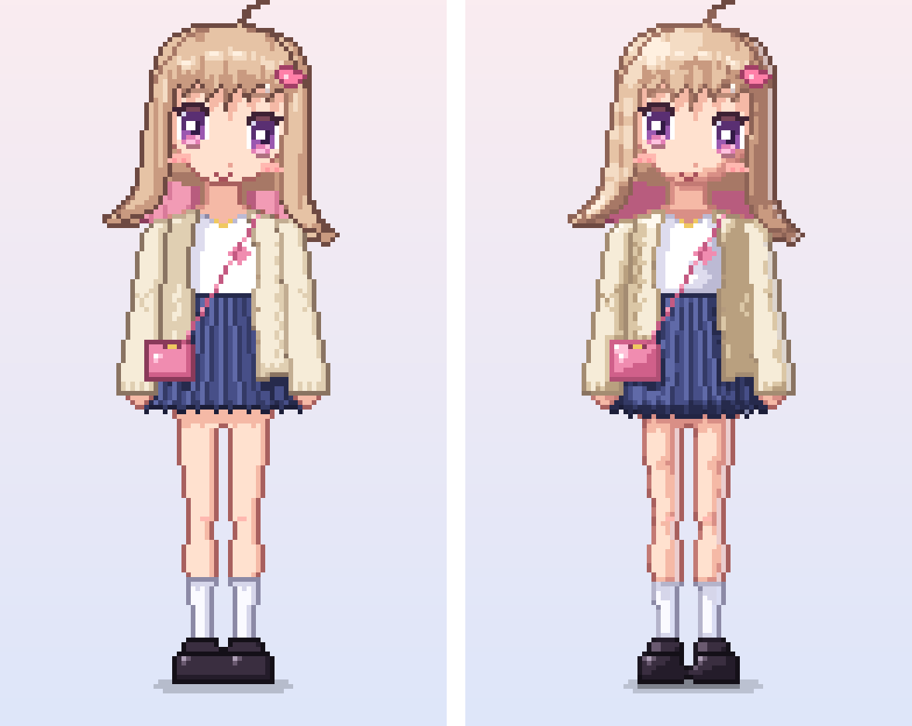

左が v1、右が v2。v1 は影が輪郭のすぐ内側に 1〜2px しかなく、平面的でした（診断は docs/08 8-0）。

| 改善 | 内容 | docs/08 |
|---|---|---|
| 法線推定シェーディング | マスクから高さと法線を推定し、光との内積で hi / lt / base / s1 / s2 を決定。影が形に沿った太い帯になった | 8-10 |
| 髪を1つの球に | 後ろ髪・横髪・前髪をまとめた「頭」の球で明暗を付け、束の厚みを足した。左上が明るく右下が暗い | 8-5 |
| 胴は中身の形で | カーディガンのシルエットではなく、中身の胴の形で陰影を計算（以前は影が袖の下に隠れていた） | 8-5 |
| 顔は縁だけ丸い板 | 顔全体に陰影を付けると汚れて見えたため、縁 4px だけ丸めて右頬と顎の下だけに影 | 8-5 |
| オクルージョン影 | 手前のパーツと接する所を1段暗く。太ももの内側も暗く | 8-2 |
| ディテールは段階で | プリーツ・リブ・皺・天使の輪を「段階の上げ下げ」に変更。影の中でも見える | 8-5 |
| クロスコンター | スカートの裾とソックスの口を、体の丸みに沿って下に膨らむ弧に | 8-7 |
| 線の強弱 | 明部は明るい線、影は濃い線 | 8-6 |
| リムライト | 影側の輪郭の1px内側に淡い青の照り返し。背景から浮き上がる | 8-9 |
| 接地影・すき間 | 靴底の真下に濃い接地影、左右の靴の間にすき間 | 8-8 |
| コントラスト | カーディガンの影色を濃くして、ベースとの明度差を広げた | 8-4 |

### まだ残っている課題
正面・直立のポーズは、奥行きの手がかりが最も少ない構図です（docs/08 8-8）。さらに立体感を出すには、3/4 向き・腕や脚の重なり・コントラポストを使ったポーズで描き直すのが最も効果的です。

---

## 5. v3：体の比率・顔の比率・ポーズ・人体構造の見直し（docs/09 を適用）

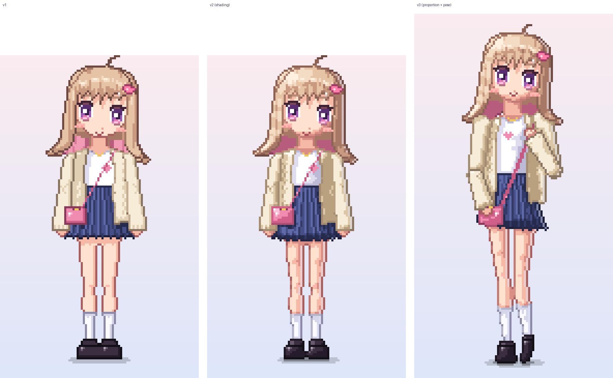

### 計測で分かった v2 の問題 → v3 の値
| 項目 | 目安 | v2 | v3 |
|---|---|---|---|
| 頭身 | 5〜6 | 4.59 | 5.41 |
| 首の長さ（÷頭の高さ） | 0.25〜0.35 | 0.20 | 0.24 |
| 上腕の長さ（÷頭の高さ） | 0.9〜1.1 | 0.57 | 0.96 |
| 腕を下ろした時の指先 − 股 | 太ももの中ほど | 腰の位置で止まる | +0.70H |
| 肩幅 ÷ 顔の幅 | 1.4〜1.7 | 1.23 | 1.42 |
| 口の位置（÷頭の高さ） | 0.83〜0.88 | 0.92 | 0.87 |
| 重心 | 頸窩の真下に支持脚 | 両足の中央（棒立ち） | 支持脚の足の上 |
| 肩・骨盤 | 逆向きに傾く | 水平 | −5.7° / +5.9° |
| 手足の左右差 | 非対称 | 鏡写し | 片腕を曲げ、片脚を遊脚に |

### 描き方の変更
| 変更 | 内容 |
|---|---|
| 骨格から描く | 関節の座標（`POSE`）→ 骨に沿った肉付け（`segment()`）。骨の長さ（`BONES`）を超えていないか `report()` で確認 |
| 解剖学的な太さ | 太ももは外側がなだらか・内側が膝上でふくらむ、ふくらはぎは外側が高く内側が低く大きい（docs/09 9-4 の表。v4 で向きを訂正） |
| 胴の側屈 | 胴を高さごとに肩の傾き→骨盤の傾きへ回し、体重側の脇腹を縮める（`torso_xf()`） |
| 髪の重力 | 頭を傾けても、顎より下の髪は真下に垂れる |
| 腕の重なり | 上腕と前腕を別パーツにし、曲げた腕の前腕を手前に。手前のパーツは濃い線（前後関係） |
| 脚の重なり | 遊脚（膝が前に出る）を支持脚の手前に描く |
| 顔 | 鼻と口を上げ、口と顎の間を空けた |
| 足 | 支持脚は平らに接地、遊脚はつま先立ちで内向き。接地影も遊脚はつま先だけ |

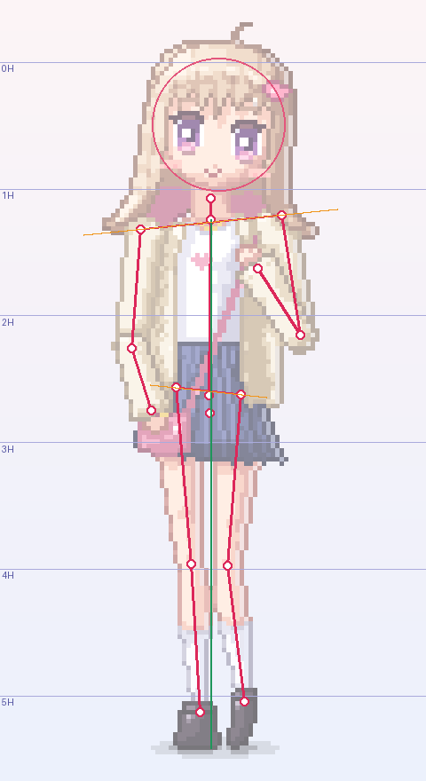

### まだ残っている課題
- 体はほぼ正面向き。体を 3/4 向きにひねると、さらに奥行きと動きが出る（顔・胴の中心線をずらし、奥側を縮める変換が必要）。
- 手はまだ小さな塊と指の境目だけ。手のアップや手のポーズを使うなら、手の文字グリッドのテンプレートを用意する必要がある。

---

## 6. v4：3D の人体モデルを作り、アニメ調で描画（docs/10 を適用）

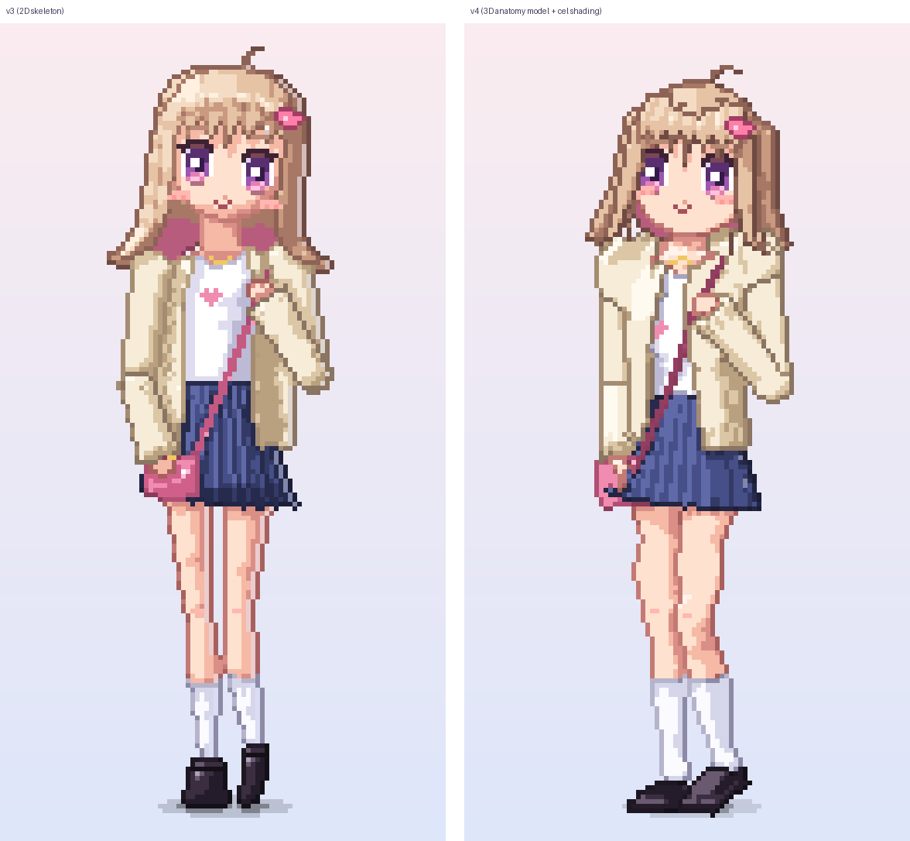

v1〜v3 は「正面から見た輪郭」を直接描いていたため、骨格や筋肉の前後の厚みが無く、向きも変えられませんでした。v4 では体を 3D のモデルとして作り、それをドット絵として描画しています（`draw_mio_3d.py`）。

| 段階 | 内容 |
|---|---|
| 骨格 | 関節を比率表とポーズで決め、腕・脚は 2 ボーン IK で骨の長さを厳密に守る |
| 骨の目印 | 鎖骨、肩峰、大転子、大腿骨の顆、膝蓋骨、脛骨粗面、脛骨、内・外くるぶし、肘頭、上顆、手首 |
| 筋肉 | 胸鎖乳突筋、僧帽筋、三角筋、上腕二頭筋・三頭筋、上腕筋、腕橈骨筋、前腕の屈筋・伸筋、大腿直筋、外側広筋、内側広筋、内転筋群、ハムストリングス、腓腹筋（内側頭・外側頭）、ヒラメ筋、前脛骨筋、アキレス腱、胸郭・胸・腹・骨盤・大殿筋 |
| 合成 | 楕円体と円錐を smooth min（k=3.0）でなめらかに合成。k でアニメ度を調整 |
| 服・髪 | 体をふくらませた殻（T シャツ・カーディガン）、プリーツを本当に折った楕円錐（スカート）、すねの殻（ソックス）、毛束の円錐の集まり（髪） |
| 描画 | レイ・マーチングで深度・法線・ID → セル塗り 5 段階、光線で落ち影、オクルージョン、顔は球の法線（法線転写）、髪は鏡面反射の天使の輪、リムライト、深度と ID の差で輪郭線 |
| 顔 | 目・眉・口・頬を 3D 位置から投影してドットのスタンプで描く。奥の目は1列狭い |
| 構図 | 体を −18° 回した 3/4 向き、5° 見下ろし、顔は体よりこちらへ 9° |

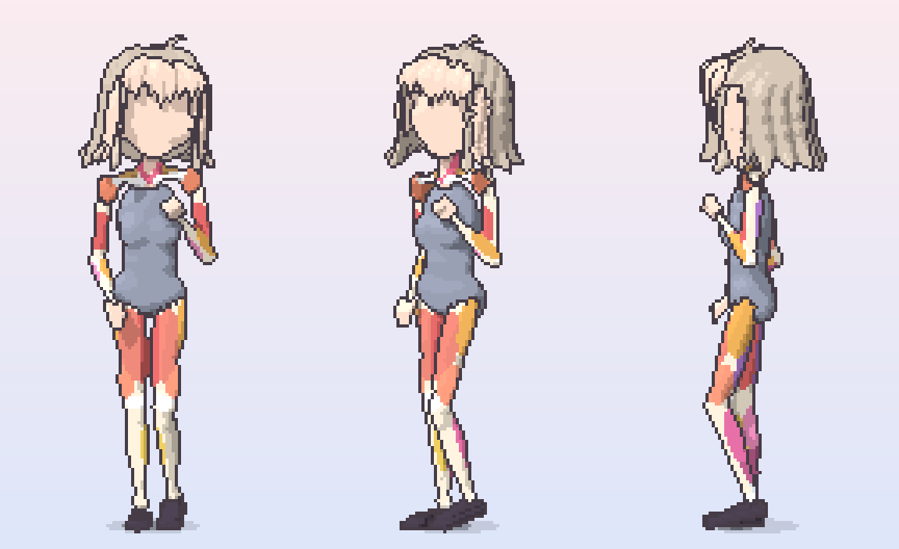

### 調べて分かった誤りの訂正
ふくらはぎのふくらみの高さを、これまで「内側が高い」と書いていましたが、正しくは **外側が高く、内側が低い位置で大きい** です（くるぶしは内側が高い）。docs/01・09、v3 のスクリプト（`draw_mio.py`）の太さの表も訂正しました。

### まだ残っている課題
- 手は小さな楕円体と円錐だけで、指は作っていない（このサイズでは見えないため）。手のアップを描くなら指の骨格が必要。
- 髪の毛束はまだ規則的で、2D 版（v3）ほど流れのある毛先になっていない。
- 顔の影は法線転写のみ。光の角度を大きく変えると、SDF 顔影マップのような専用の工夫が必要になる。

---

## 7. v5：アニメ顔に合う比率・顔の輪郭・髪型・2020年代の目（docs/11 を適用）

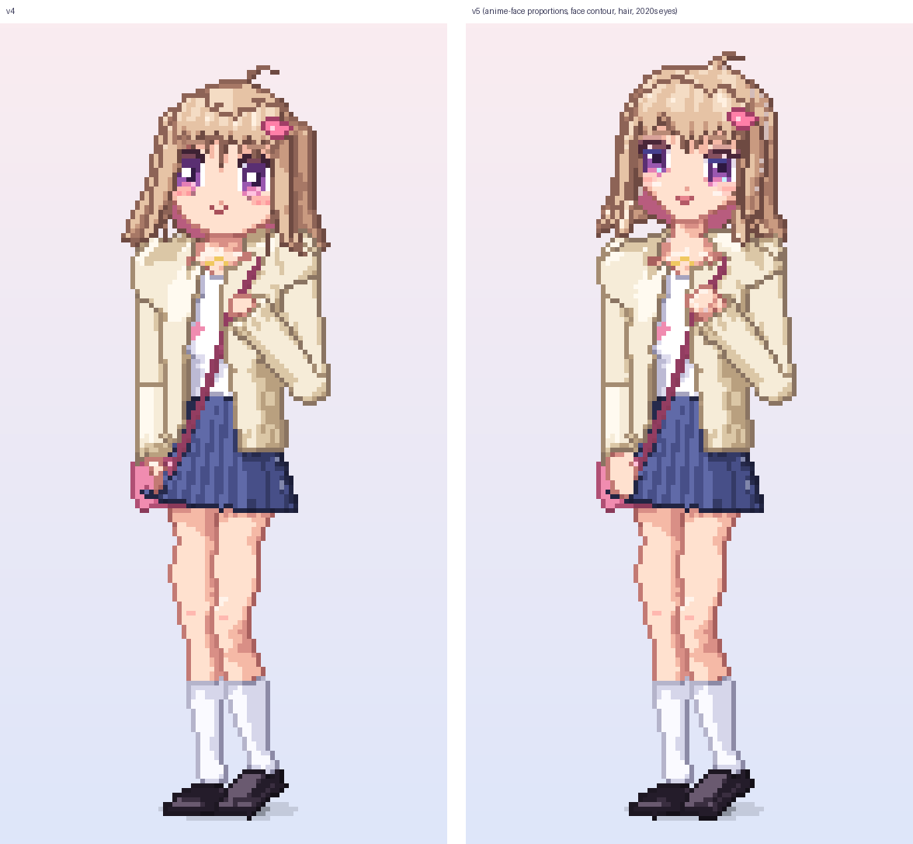

| 変更 | v4 | v5 |
|---|---|---|
| 首の長さ | 約0.17 頭（頭が肩に埋まる） | 0.28 頭 |
| 手 | 拳の長さ 約0.2 頭（小さすぎ） | 0.38 頭。手のひら＋指4本＋親指で、ストラップを握る拳とバッグに添える手 |
| 足 | 0.62 頭 | 0.67 頭 |
| カーディガンの肩 | 体を +2.3 ふくらませた箱型 | +1.9（肩の箱っぽさを弱めた） |
| 顔の輪郭 | 頬と顎が1つの楕円体（顎まで広い丸顔） | 頬（目の下が一番広い）＋顎へ細くなる円錐＋小さな顎先＋頬骨 |
| 目の位置 | 両目の間 0.75、目尻〜輪郭 0.16 | 0.82、0.22 |
| 髪 | 等間隔・同じ太さの円錐（櫛のよう） | つむじから頭の丸みに沿う毛束 13 本（大・中・小）、分け目から放射状の前髪 8 本、S 字の横髪。分かれ目は下の方だけ、髪の中の線を減らした |
| 目 | 縦長 8×10、大きな四角いハイライト、一定の太さの黒っぽいまつ毛 | 横長 8×8、二重、目尻が太いまつ毛と毛束、白抜き、たれ目、まぶたの影、瞳の上部の青紫の差し色、虹彩のふち、1px のハイライト、補色のきらめき、目頭の赤み、目尻側の下まつ毛、涙袋 |
| 頬・口 | 斜線のチーク、線だけの口 | 目の下の横長のやわらかい赤み、小さく開いたピンクの口 |
| 前髪と目 | まつ毛が前髪に隠れて眠そう | 目元を前髪の上に透かして描く |

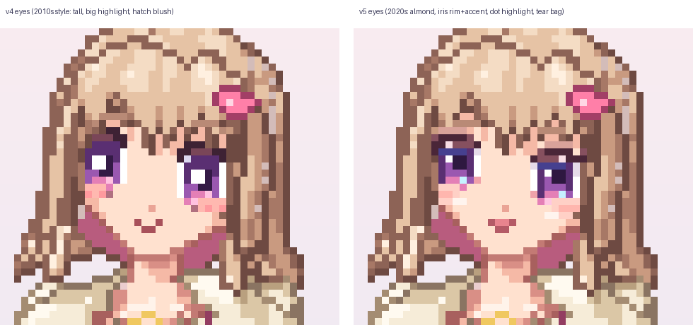

### まだ残っている課題
- 髪の毛先の流れ（風や動き）、ハイライトの形の作り込み。
- 目のテンプレートは1種類（たれ目・おっとり）。表情差分（笑い目、驚きなど）を 2020年代風で作る必要がある。

---

## 8. v6：もっと可愛く（docs/12 を適用）

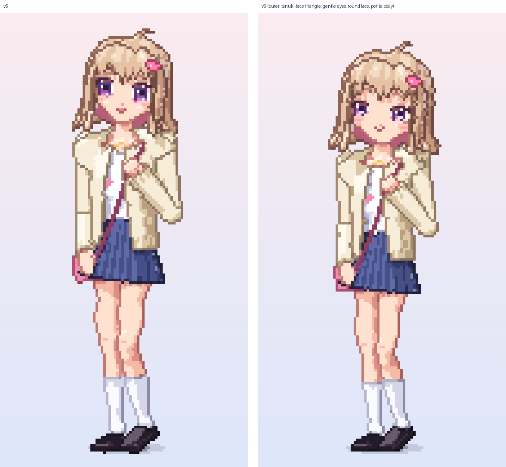

| 変更 | v5 | v6 |
|---|---|---|
| 頭身 | 5.23 | 4.75（頭 1.06 倍、首から下 0.94 倍） |
| 顔 | 頬〜顎が V 寄り | 頬をふっくら、顎を小さく丸く（U 寄り） |
| 目と口の三角形（高さ÷両目の間隔） | 0.49 | 0.43（目を下げ、口を目に近づけた狸顔の比率） |
| 目の位置 | 0.57 | 0.62（額を広く） |
| 両目の間 | 片目の幅の 0.82 | 0.93（少し離れ気味） |
| 目 | 8×8（頭の 0.26） | 8×6（頭の 0.19）：瞳の上部が少しまぶたに隠れる優しいたれ目、黒目がち、瞳が上下のまぶたに接する |
| 口・眉 | 小さく開いた口、まっすぐな眉 | 口角を上げた ∪、眉頭を少し上げたほんのり困り眉 |
| 体 | 肩幅＝顔の 1.47 | 1.24（小柄、手足も細く） |

途中で目を 9×9 に大きくした版は「目が大きすぎて違和感がある」との指摘を受け、半目のテンプレートくらいの大きさ（8×6）にしました（`eye_size_study.png`）。

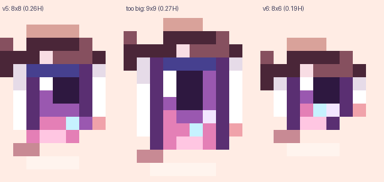
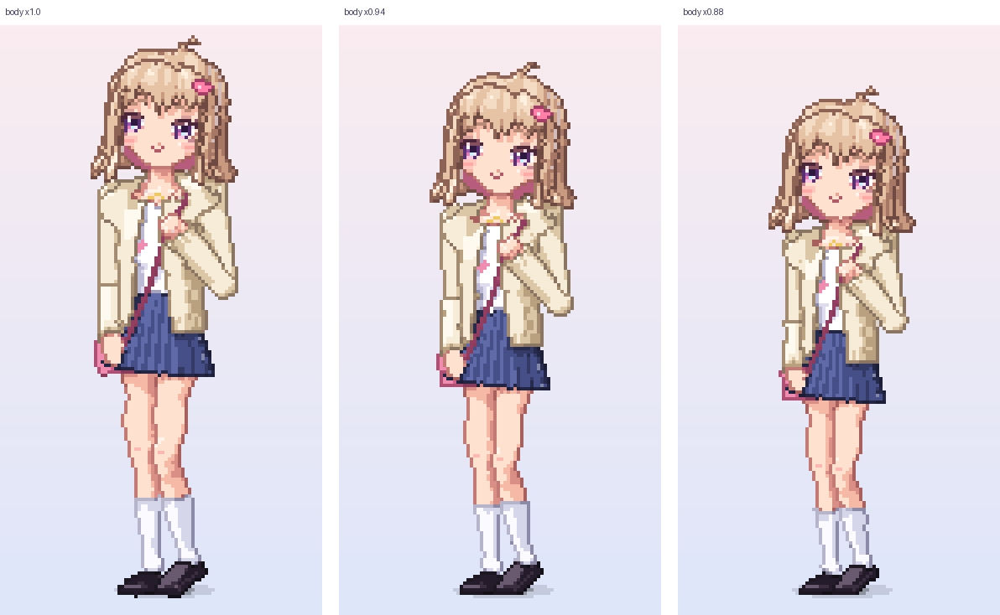

---

## 9. v7：「丸で組み立てる」絵柄（docs/13 を適用）

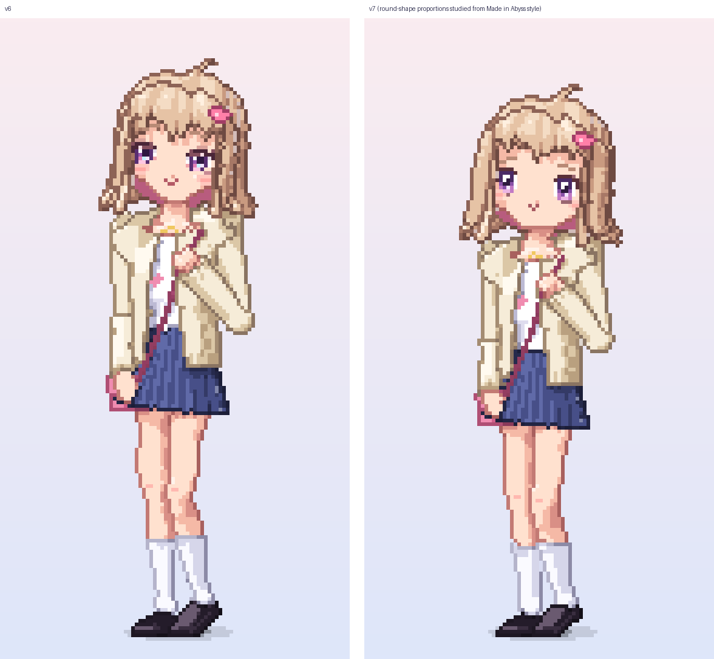
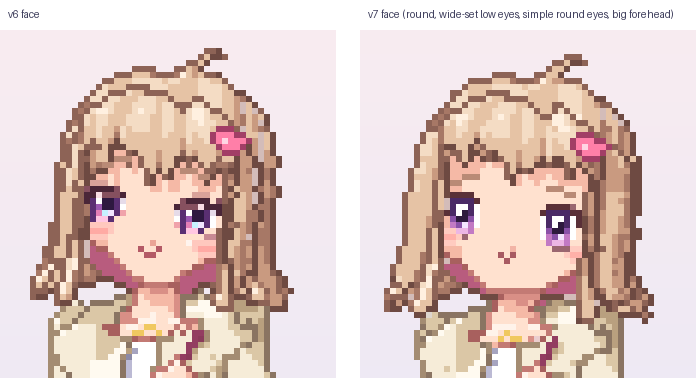

『メイドインアビス』の絵柄から「形の作り方と比率の原理」を取り出して反映しました（特定のキャラクターのデザインは真似していません）。

| 変更 | v6 | v7 |
|---|---|---|
| 頭身 | 4.75 | 4.45（頭 1.08 倍、首から下 0.88 倍） |
| 顔 | 頬ふっくら | 頭蓋を横に広く、頬を大きく、顎を幅広い丸に（円で組み立てる） |
| 目 | 2020年代風 8×6 | 丸く単純な 7×7（ハイライト大1＋小1、まつ毛は目尻に1本）。低く（0.65）、離して（片目の幅の 1.44 倍） |
| 鼻・口 | 1px の影、4px の ∪ | ごく淡い 1px、3px の小さな口（目と口の三角形 0.43 → 0.30） |
| 髪 | 前髪で額が隠れ、横髪が頬に重なる | 前髪を短くして額を見せ、横髪を外へずらして丸い頬を見せる |
| 体 | k=3.0 | k=4.0（筋肉の起伏が無い丸く柔らかい体）、なで肩・小さな手足 |

v6 の設定は `apply_preset("v6")` で再現できます。

---

## 10. v8：v6 に戻して小さく改良＋単純化（docs/14 を適用）

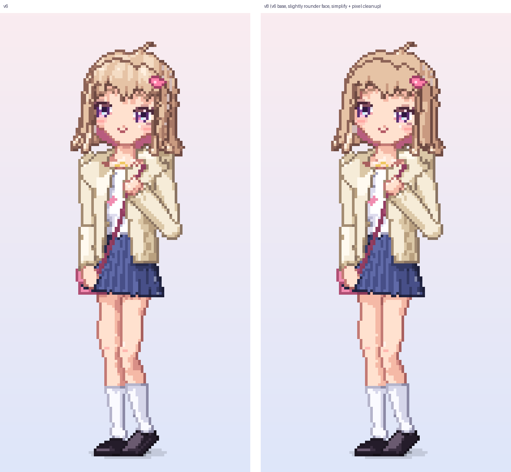
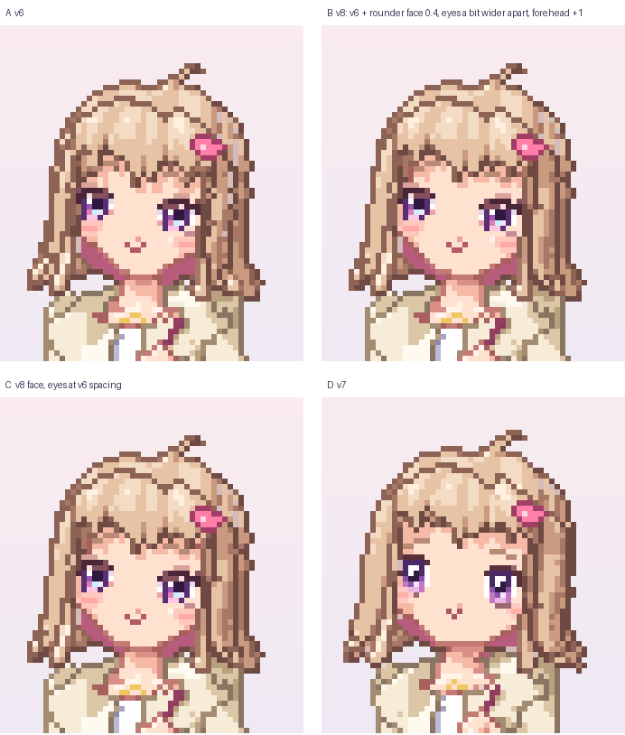
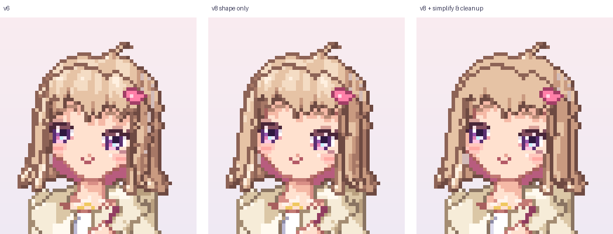

v7 は一度に多くを変えすぎて悪化したため、**v6 を基準に戻し、変更を小さく** しました。さらに他の作品とドット絵の技法の調査（docs/14）から「全体は単純に、目と口は丁寧に」を取り入れ、陰影の段数を減らして孤立ピクセルを自動で掃除しています。

| 変更 | v6 | v8 |
|---|---|---|
| 顔の丸さ | 0（v7＝1） | 0.4 |
| 両目の間 ÷ 目の幅 | 0.93 | 1.01（v7 は 1.44） |
| 目と口の三角形 T | 0.43 | 0.41 |
| 額・横髪 | 前髪で隠れる・頬に重なる | 前髪を少し上げ、横髪を少し外へ |
| 顔・髪の陰影 | 4段 | 2段（髪は天使の輪を少し広く） |
| 服の一番暗い影 | 遮蔽のある所すべて | 深い隙間だけ |
| 髪の中の線 | 深さの差 5.0 以上 | 7.5 以上 |
| 孤立ピクセル | そのまま | 自動で掃除（`cleanup()`） |

頭身 4.75、目の大きさ 8×6、体の大きさ 0.94 倍は v6 と同じです。各版は `apply_preset("v6" / "v7" / "v8")` で再現できます。

### 眉の修正

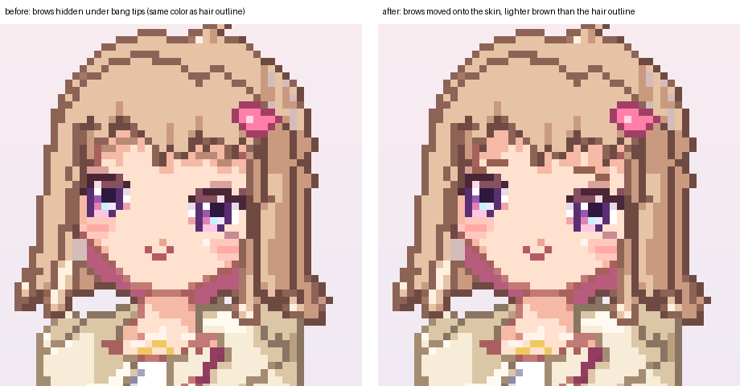

眉は描いていましたが、前髪の毛先の輪郭線と同じ位置・ほぼ同じ色だったため見えていませんでした。眉を前髪と目の間の肌の上に下げ（奥の眉はさらに少し下げる）、色を輪郭線より明るい茶色（#96604f）にしました（docs/14 14-7）。

---

## 11. v9（HD）：解像度を上げて、プロの描き方を取り入れる（docs/15 を適用）

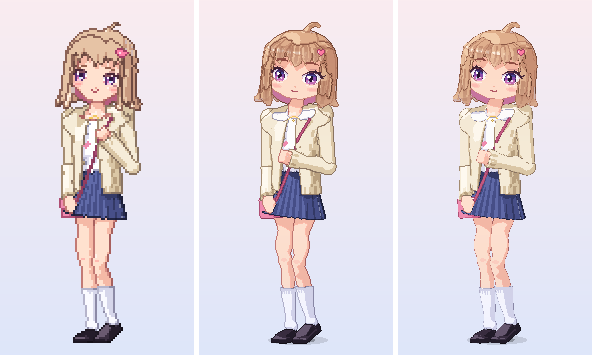
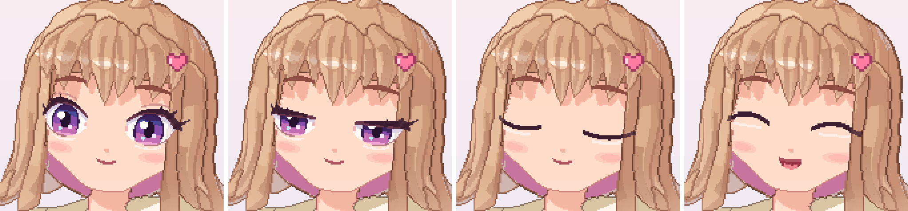

解像度を 4 倍（384×704px）にし、プロのイラストレーター・ドット絵師の描き方を調べて反映しました（左から v8、v9 の 2 倍版、v9 の 4 倍版）。

| 変更 | v8 | v9（HD） |
|---|---|---|
| 解像度 | 96×176 | 384×704（192×352 版も） |
| 目 | 8×6px のスタンプ | 頭の表面の模様として式で描く。目尻へ太くなる上まぶた、根元が太いまつ毛 3 本、5 段の瞳、ハイライト 3 つ、白目の落ち影 |
| 眉 | 肌の上 | 前髪の上の透け眉 |
| 表情 | 開き・半目・閉じ | ＋にっこり |
| 髪 | 2 段 | 法線を球へ寄せて影を大きな形に、尖った毛先、束の影と毛流れの線、毛先の透け、束ごとのレンズ形の天使の輪、影側だけ太い輪郭 |
| 肌 | ベタ＋影 | 顔の影は額だけ（やつれて見えないように）、手足は 2 段の塗り、影の境目に明るいサーモンピンク |
| ポーズ・体 | 手が首元、襟ぐりが広い | 手をみぞおちの高さで紐を握らせ、小さな丸首に、脚を少し細く |
| 仕上げ | — | 上は暖色・下は寒色のわずかな色調補正 |

### 顔の輪郭と髪型の作り直し

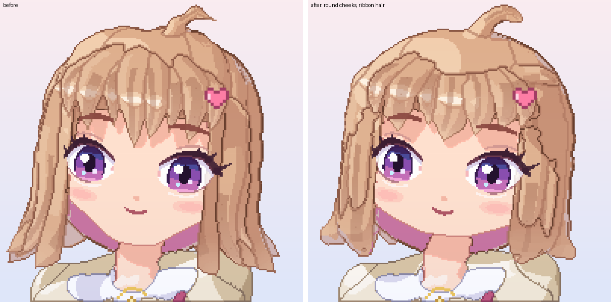

顔は口から顎までを短くして頬にふくらみを足し、髪は平たいリボン状の毛束で作り直しました（後ろ髪は内巻き中心のボブ、横髪は頬に沿って顔を包む、前髪は大・中・小の 7 束）。docs/15 15-11。
